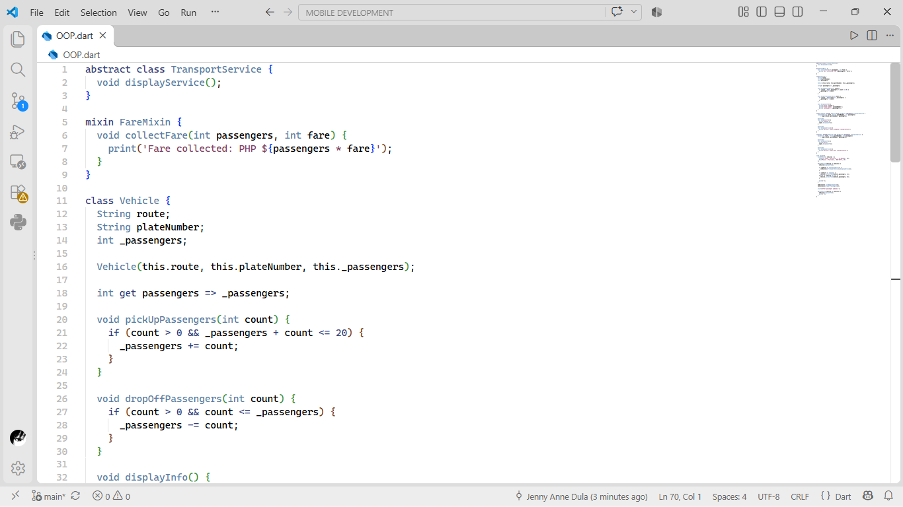

# Week 10 - OOP in Dart

This project is an enhanced version of my Week 9 Jeepney OOP program. It demonstrates inheritance, polymorphism, abstract classes, and mixins using real-world transportation examples.

## Features

- Base class: `Vehicle`
- Derived classes: `Jeepney` and `Bus`
- Method overriding
- Abstract class: `TransportService`
- Mixin: `FareMixin`
- Passenger management and fare calculation

## Program Output

## Source Code

### Vehicle and TransportService

### Jeepney, Bus, and FareMixin

## Language

Dart

## Author

BSIT Student - PC16 Mobile Development with Lab